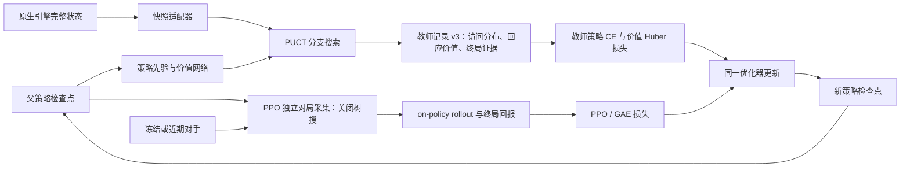

# 搜索训练框架快速导读

日期：2026-10-31

## 一句话说明

这套方案从既有的 2.6 速猪策略检查点继续训练：用 PUCT 搜索评估候选动作，生成策略分布和值目标作为教师数据；另外采集不带树搜的 on-policy PPO 对局。训练器把两类目标放进同一个 PPO 优化步骤，逐轮更新策略。

因此，**树搜负责提供更强的动作和值监督，PPO 负责产生独立的策略轨迹并驱动更新**。搜索教师局和 PPO 局是两条分开的数据流。

## 数据流

教师搜索在一个原生决策点建立根节点，通过可恢复的完整状态反复探索分支。PUCT 选择分支时综合当前动作价值 `Q` 与策略先验 `P`；高访问次数动作的价值估计更稳定，先验较高但访问较少的动作仍有探索机会。搜索结束后，根节点动作访问次数归一化为教师策略分布。

教师价值也会检查冻结对手的回应。对手策略按概率取 Top-4 回应并逐一评估，得到期望值 `Q_expected` 和最差正概率回应值 `Q_robust`；目标为 `0.7 × Q_expected + 0.3 × Q_robust`。缺少任何要求的回应值或终局证据时，该记录不进入训练。

## 两类训练数据

**PUCT 教师数据**提供两种监督：教师访问分布与当前策略分布之间的交叉熵，以及价值网络预测与 `Q_target` 之间的 Huber 损失。教师记录保存搜索根节点的语义输入、动作合法性掩码、访问次数、冻结对手回应及自然终局证据。只按完整对局切分 train/validation/test，避免同一局的相邻决策泄漏到多个集合。

**PPO 对局数据**由当前策略直接行动，不使用树搜动作作为行为策略。每次更新的计划配额为 72 局自博弈、12 局对固定第 1250 轮策略、24 局对近期策略，共 108 局。完整 on-policy rollout 通过现有 PPO/GAE 路径生成更新损失。

两个损失在同一个 PPO AdamW 更新中合并。计划共 200 次更新；教师策略/价值损失权重在前 100 次更新较高，之后线性衰减：策略损失从 0.50 到 0.25，价值损失从 0.10 到 0.05。优化器状态从指定父检查点恢复，并在写出候选检查点后读回校验。

## 关键参数

| 项目 | 当前合同 |
|---|---|
| 学习对象 | Hog / 2.6 速猪专精 |
| 父检查点 | 第 1755 轮；第 1553 轮仅作回归基线 |
| 原型搜索 | 每个根节点 32 次模拟 |
| 教师搜索 | 通常 128 次模拟；高不确定性根节点复查 256 次 |
| 单条搜索路径 | 最多推进 6 个决策点；另有原生推进时间预算 |
| 对手回应 | 冻结对手策略 Top-4，temperature 0.5 |
| 训练探索 | 我方根节点 Dirichlet `alpha=0.25`、`epsilon=0.25` |
| 教师周期 | 计划每周期 216 局，每局 128 次模拟 |
| PPO 更新 | 计划每次更新 108 局，合计 200 次更新 |
| 最终评估 | 计划第 200 轮对第 1755 轮评估 6000 局，关闭树搜 |

模拟次数是每个搜索根的预算，不是单局模拟总数；6 是一条分支路径的决策深度上限，也不是固定深度。原生推进预算以实际调用耗时计，不等同于游戏内时间。

## 为什么需要完整状态

搜索要在同一根节点比较不同动作，必须能准确保存和恢复每个分支。`tree-search-state.v1` 除原生快照外，还绑定未截断观察、合法动作、外部动作队列、奖励账本、事件游标和策略循环状态。原生快照是恢复分支的依据；适配器还要比较执行摘要，确认相同分支重放仍产生相同状态。

卡组标识用于输入身份绑定、对手配置与审计，不作为策略观察特征。缺字段、动作掩码不一致、快照摘要变化、冻结对手回应不全或对局被截断时，验证器拒收记录。

## 当前进度

- **工程实现**：PUCT 搜索、原生状态适配、教师记录 v1/v2/v3、教师损失、PPO 接入、训练计划校验和五机部署/预检工具均已存在于代码库。
- **原型批次**：项目导读记录五机原型 `108/108` 局自然终局、每根 32 次模拟通过。这验证了有界原型闭环，不等同于正式教师数据集或完整训练。
- **正式采集与训练**：正式启动仍要求新鲜的五机资源和引擎预检、完整 216 局教师周期，以及与父检查点匹配的 108 局独立 PPO rollout。公开状态记录自动化正式采集和后续轮次调度尚待接通；200 次更新与 6000 局最终评估仍未作为已完成结果。
- **Mac / ARM Linux**：Python/PyTorch 搜索和数据合同与平台分离，但原生分支搜索依赖真实 ART/Bionic 引擎、可恢复快照及匹配资源。现有正式部署工具面向五台 Linux worker，并检查 resident/QEMU 运行文件；不能把本机 AVD 与 Ubuntu guest 的 warm-step 速度对照当成 PUCT 吞吐或训练迁移验收。将 Mac 用作开发/调度机相对直接；把训练器放到 Mac 或把 worker 迁到 ARM Linux，仍需分别验证 PyTorch 设备后端、引擎运行闭包、检查点恢复和端到端训练。

## 代码入口

| 文件 | 职责 |
|---|---|
| [`tree_search.py`](../firstlight_CR/research/puct-runtime/tree_search.py) | PUCT 节点、分支选择、回传与搜索预算 |
| [`native_adapter.py`](../firstlight_CR/research/puct-runtime/native_adapter.py) | 原生完整快照保存/恢复、动作推进和状态一致性 |
| [`event_puct_acceptance.py`](../firstlight_CR/research/puct-runtime/event_puct_acceptance.py) | 单根搜索、冻结对手回应估值与教师局结算 |
| [`distillation.py`](../firstlight_CR/research/puct-runtime/distillation.py) | 教师记录合同、损失与权重 schedule |
| [`collect_policy_episode.py`](../firstlight_CR/research/puct-runtime/collect_policy_episode.py) | 独立 on-policy PPO 对局采集 |
| [`teacher_training.py`](../firstlight_CR/research/puct-runtime/teacher_training.py) | 验证教师记录并计算教师目标 |
| [`train_with_teacher.py`](../firstlight_CR/research/puct-runtime/train_with_teacher.py) | 组合 PPO 与教师损失、检查优化器和检查点读回 |
| [`research/puct-runtime/README.md`](../firstlight_CR/research/puct-runtime/README.md) | 当前完整运行合同、批次门槛和部署流程 |

## 读者可先记住三点

1. PUCT 是高成本教师标签生成器，PPO rollout 不用搜索行为当策略数据。
2. 搜索质量依赖可复现的原生快照恢复；教师记录必须能追溯到合法动作、冻结回应和自然终局。
3. 原型通过不代表正式训练通过；正式五机采集、200 次优化更新和最终无搜索评估是后续独立门槛。
