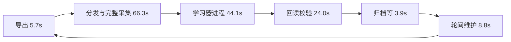

# 完整 RL 轮次流程复查

2026-09-18 23:03（北京时间）快照。对象为当前实际运行的 `.34:/home/gujiga/firstlight_CR/runs/event-residual-v3-300r-20260918`，从第 251 轮续训至 551；抽样时第 285 轮正在更新。本文使用第 **275–284 轮、1,080 局**的真实日志，另以当前代码对历史 checkpoint/轨迹做只读 CPU 剖析。没有修改正式训练代码、配置、权重或进程。

## 当前已生效的优化

当前 `fleet_runtime.py:update` 明确传入 `--row-batch-size 128 --input-cache-mib 512`，正式更新日志确认 `preflight_values_reused=true`。例如第 284 轮 3,637 条决策，29 个 batch，384.6 MB 观测缓存。

采集使用 `collector-idlefix-code`：五台机器共享 GPU 推理服务、最大 batch 16、额外等候 2 ms、按需观测、WAIT 快路、常驻 worker、推理专用 artifact 和按主机批量回传均已启用。JSON 仍是正式 capture 格式。此前的优化建议不能再当成未实施项目。

## 一轮真正花在哪里

以相邻两次 `iteration-start` 计算完整周期，平均 **152.76 秒**，范围 **136.24–165.58 秒**。

| 串行阶段 | 平均秒/轮 | 依据与边界 |
|---|---:|---|
| 推理 artifact 导出 | 5.67 | 明确的 inference-export 计时 |
| 分发、采集、回传 | 66.29 | fleet-barrier 减 iteration-start，再扣导出；含完整 108 局 |
| 学习器进程启动至最后输出 | 44.07 | update.log 最后 mtime 减 update-start，近似阶段计时 |
| 独立校验进程及进程交接 | 24.04 | update-verified 减 update.log 最后 mtime；含进程退出/启动等 |
| 发布、归档和旧权重清理 | 3.88 | iteration-success 减 update-verified |
| success 后维护与下一轮前清理 | 8.81 | 下一次 iteration-start 减本轮 success |
| **完整周期** | **152.76** | 不是仅统计 start 到 success |

两个 mtime 差分不是新增的精准函数计时，但 10 轮的回读阶段稳定在 23.91–24.33 秒，结合实际子进程代码和独立测量，可以明确定位固定开销。profile 在上述样本结束之后运行，因此没有影响这 10 轮基线。

## 优先级 1：学习器、回读校验常驻，并合并导出

collector 已常驻，但每轮还有三个冷进程：推理 artifact 导出、学习器更新、保存后的独立验证。学习器每次导入依赖、构建语义目录、模型和优化器；验证程序又重新构建子模型和父模型。

当前代码的只读测量（单线程 CPU、低调度优先级，使用同架构历史权重）：

| 操作 | 秒 |
|---|---:|
| 导入 torch / checkpoint / preflight | 4.05 |
| 首次 strict load 子模型 | 15.34 |
| 静态资源已缓存后 strict load 父模型 | 2.16 |
| 验证 snapshot、父身份、有限参数和计数 | 0.061 |
| 父文件 SHA + payload/计数读取，不构建模型 | 0.746 |
| 同进程再次 strict load 子模型 | 2.01 |

这些测量说明 24 秒校验段主要是冷启动和重复模型构建，真正断言耗时很小。改进方案：

1. learner 常驻内存中的模型、静态目录和 AdamW；每轮只接收新的完整 rollout，异常恢复仍从 durable checkpoint 开始。
2. verifier 常驻，读取刚落盘的子文件并做 hash、契约、strict load、有限值与步数核验；父 checkpoint 身份和计数由已验证 manifest/payload 提供，不重新构建父网络。保留落盘回读，不能只检验内存中的模型。
3. checkpoint 保存并确定 source hash 后，直接导出推理 artifact；同一常驻进程已加载 torch，避免下一轮再起 export CLI。推理 artifact 独立 hash 与 source hash 绑定不变。

可设 **每轮减少约 35–45 秒固定开销**为实施后的待验证目标，主要来自约 20 秒 learner 初始化、约 20 秒 verifier 冷启动差额与约 5.7 秒导出路径中的可省部分。此范围不是已经测得的整轮收益，也不能把全部阶段耗时都算成可消除时间；文件读取、strict load、保存仍需执行。

## 优先级 2：观测从批量文件直接进 batch，避免拆开再拼回

历史 108 个 shard / 3,970 条决策，用当前 reader 的 cProfile：

| 读取路径 | 累计秒 | 调用数 |
|---|---:|---:|
| load_complete_rollout | 10.84 | 1 |
| lanes_from_shard | 9.23 | 108 |
| 其中 observation(index) | 9.08 | 3,970 |
| 其中 Tensor.narrow（self） | 4.44 | **484,340** |
| load_event_rl_shard（文件/容器与结构加载） | 1.52 | 108 |

累计项嵌套，不能相加；cProfile 本身会放大大量小调用的成本。此前不带 profiler 的同批读取约 8 秒，不能将 9.08 秒直接当成确定可节省时间。

源数据已经是 safetensors 批量张量，当前 reader 却为每条观测递归 narrow 所有字段、裁剪动态容量并构建 dataclass；随后 `PreparedEventRollout` 再 padding/cat 回 batch。这是清楚的结构性浪费。

建议将轨迹时间顺序保留为 `(shard, row)` 索引与 lane spans，直接从 shard 批量选择行，按 batch 做一次动态维度 padding；GAE 的完整轨迹边界和逐行 action/mask/log-prob 对齐保持。schema、hash、终局及非有限值校验照常执行。先用固定历史数据比较输入张量、概率、GAE、梯度和一次更新结果，验证后再接入。

## 优先级 3：合并维护请求，去掉空工作

第 275–284 轮，每轮都发生：

- `.34/.35/.39/.41` 各清理一份旧推理 artifact。`maintenance.py` 按主机串行“列目录 → 去 .37 验证归档 → 回目标主机验证并清理”。同一份归档被重复核验四次。
- `.34` 因可用空间低于 8 GB，每轮前清理一份已有 `.37` 归档的完整 checkpoint；当前只剩初始和近期权重，单轮清理不足以达到 12 GB 水位。
- `.39` 的旧完整 `weights` 目录在这 10 轮均没有待清理文件，仍执行列举与清理两个远端命令，结果一直是 `removed=[]`、`freed_bytes=0`。正式推理使用的是另一个 `collector-weights` 目录。

建议去掉持久采集模式下已经失效的旧完整权重清理路径。推理 artifact 收集候选集后对 `.37` 去重批量验证一次，再并行处理各主机已核验的历史文件。归档确认、当前版本保留和失败不删的规则继续保留。

维护可以与当前轮采集/更新重叠，但只能处理既非当前权重、也无进行中使用者的历史版本；空间不足时仍阻塞启动。每轮 success 和“维护结束/下一轮就绪”应分别计时，否则会漏掉 8.8 秒/轮。

## 优先级 4：把准备工作放入采集等待窗口

五台主机完成时间存在平均 **22.64 秒**差距；目前每台完成后虽已立即回传，该主机的完整轨迹仍等 fleet barrier 后才被 learner 读取。传输本身已很小，平均 **0.50 秒/主机**，最大 0.66 秒。

常驻 learner 可以在采集过程中对已完成、已校验身份的 shard 做读取、输入打包和当前权重 preflight；早完成主机的数据提前准备。最后一台到齐后，确认全部 108 局和所有行校验通过，统一做优势归一化与 PPO 更新。

这类流水线保留当前严格 on-policy：使用同一轮权重校验本轮数据，更新只发生在完整集合到齐之后。不能让下一轮采集提前使用旧权重，再当成新权重样本训练。收益和前面的 reader 优化重叠，不应重复相加。

## 优先级 5：继续测环境与推理延迟，暂缓硬件扩容

最近 1,080 局的单局平均计时：

| 项目 | 秒/局 |
|---|---:|
| 对局主循环 | 26.36 |
| 环境 step 总计 | 20.76 |
| 其中 native + typed binding | 19.07 |
| 其中 reconcile | 1.60 |
| 显式按需观测 | 1.54 |
| 模型推理调用，含 IPC/排队 | 3.14 |
| 特征准备 | 0.84 |

channel 平均总计 13.70 秒，其中 receive 12.54 秒、decode 1.15 秒。channel 与环境计时嵌套，且累计 channel 包含 priming，所以不能据此把余量全部归为 typed binding。receive 同时包含原生推进、capture/JSON 构造与传输等待，不能称为纯网络。

GPU 服务按请求加权的平均 batch 大小仅 **2.92**，实际最大配置已为 16。平均请求往返 94.9 ms，其中排队 24.8 ms、批处理 56.9 ms，剩余约 13.2 ms 含序列化/IPC等开销；每条请求都记录了所在 batch 的整批耗时，因此把 batch_seconds 对所有请求求和不是服务的总 wall time。

仅把 max batch 从 16 调大，未必有收益。应先分别量 `_stack_frames`、H2D、encoder、动作头、D2H/结果拆分的时间，再判断是否使用固定形状分桶、预分配张量和合并回传。2 ms 只是额外聚合等候上限，不代表请求总排队时间只有 2 ms。

每轮平均最慢局 63.44 秒，平均局 26.36 秒；多数环境槽在等慢局和 learner。平均对局时间/完整周期约 17.3%，只是槽位 wall-time 占比，不是 CPU 或 GPU 利用率。在先缩短串行固定成本之前，多加机器或多 GPU DDP 的优先级较低。

此前已做的原生 capture 索引、zlib-json A/B 未显示稳定整局收益；compact 缺少当前完整契约字段，仍不作为快捷替换。下一步环境优化应针对 native rich 构造与 Python typed binding 的细分计时，而不是重复实现按需观测或直接调大 tick。

## 推荐顺序

先实施常驻 learner/verifier 与同进程导出，然后做批量 reader；维护请求合并可以独立完成。之后再加采集期间预加载及推理细分优化。依次测完整相邻 start 间隔、各阶段时间和固定历史一轮数值一致性，每一步单独确认收益。

本轮没有启动新的训练或应用定时任务，没有改动正在运行的 pipeline。

证据目录：`evaluations/round-pipeline-audit-20260918/`，含完整日志抽样、统计结果、只读 profile、维护记录与实际运行源文件快照/hash。初次 profile 恰遇当前缓存按既有流程被清理，因此改用稳定保留的第 191/192 轮历史权重和数据；生产轮次日志仍取本次 275–284。
